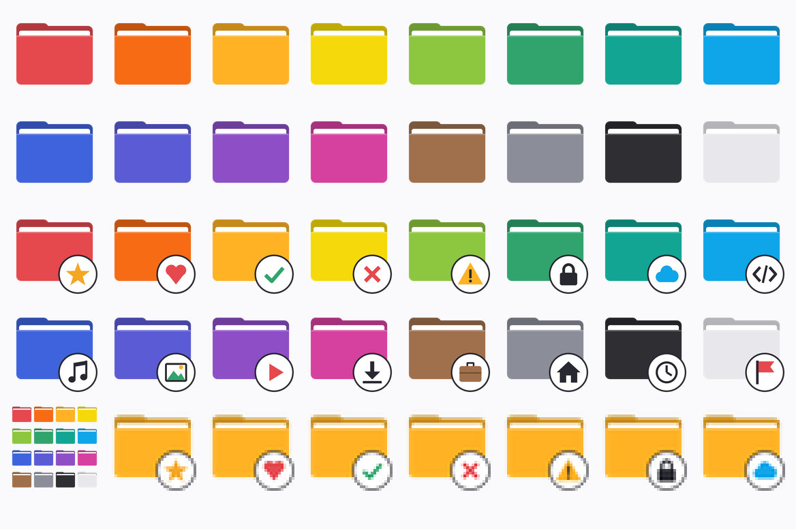
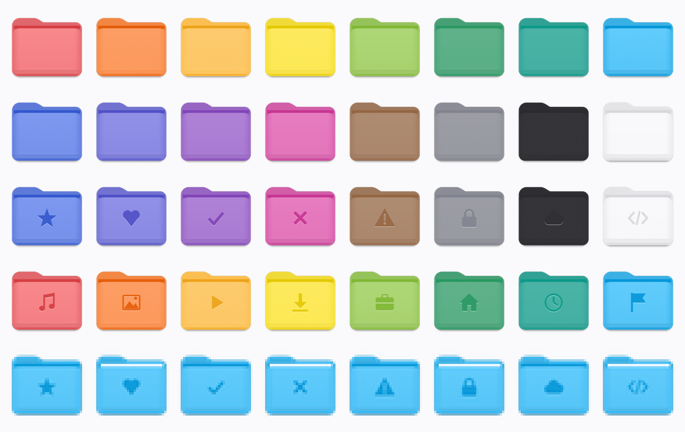

# Icon set

Generated by `tools/make_icons.py` (Python 3 + Pillow). Re-run it after changing the palette or badges.

- `folders/<color>.ico` / `.svg` — 16 plain colored folders (ICO holds 16, 24, 32, 48, 64, 128, 256 px).
- `badged/<color>-<badge>.ico` — every color combined with each of the 16 badges.
- `mac/folders/`, `mac/badged/`, `mac/preview.png` — the same colors and badges in a macOS-style look, drawn to match the reference folders the user supplied (curved tab, lighter front, bottom lip, optional `-paper` variant with a white sheet). Badges are embossed in the middle. Our own drawing.
- `preview.png` — contact sheet of the set, including how it looks at 32 px.

## Exact look from your own icon

`tools/recolor_template.py <template.ico> <out_dir> [--badges]` recolors a folder icon you supply into every palette color, keeping its exact shape and texture. The results are derived from your template, so they are for your own use unless you have the rights to the template. They are not committed here.
